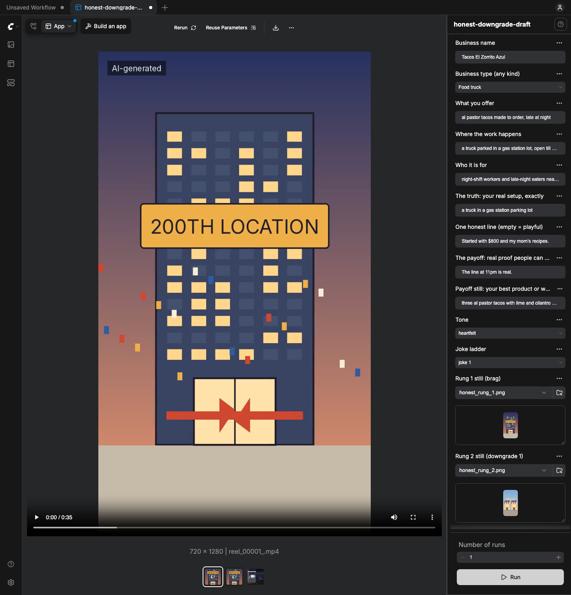

# Honest Downgrade

**Type in any small business's true facts. Get the "I'm so sorry I lied" Reel: a big brag, honest downgrades through
shock and wild-card transitions, a quiet sympathy beat, the real face of the company, and a payoff people can check.
Always video, scored music that ducks under the honest line, captions, AI label. 9:16, a full Reel plus a 15 s cutdown.**

A ComfyUI App Mode app for any small business, with a shop or without one: a plumber, a dentist, a dog groomer, a tutor,
a food truck, a bakery, a salon, a gym, an online seller, or anything else. The joke earns attention; the honest ending
earns trust. Built for the Comfy *Open Source Higgsfield* challenge, 2026. Apache-2.0. By JK Automations.

## Two ads made with this workflow

These are the two Reels our founders approved. The app is these two recipes, generalised. Both businesses are fictional.

| | Plumber (Drip Doctor Plumbing) | Taco truck (Tacos El Güero) |
|---|---|---|
| File | [`docs/examples/plumber-v5-approved.mp4`](docs/examples/plumber-v5-approved.mp4) (46.6 s, 12 MB copy) | not in this repo (kept on JK's machine) |
| Ladder | 40 work trucks → 4 trucks → one toolbox → a van and a phone that never stops ringing | 200th location → 2 locations → one window → a truck in a gas station lot |
| Transitions | shock warps: the trucks get smashed, a geyser, a tornado of pipes | wild cards: a ribbon turns into a snake, a pop-up-book fold, a flock bursting at the lens |
| Sympathy | a 2 a.m. call in the van → dad's old wrench, "My dad taught me on weekends." | none (the beat came from the plumber notes) |
| Ending | payoff macro (copper pipe), then the plumber at work | push through the window, the owner, the customers, the taco macro |
| Founder's note | "this should be the workflow we submit. always a video. include shock factor transitions. fitting music. and make the audience feel sympathy." | "feels like a commercial" |
| How it was made | the recipe of this workflow; clips drafted in Google Flow (Veo); cut by a script; Sonilo score | the recipe of this workflow; clips made with Kling O1 start/end frames; cut by a script |

Read that row honestly: those two cuts came before this app existed and were assembled outside ComfyUI. The plumber
draft also shows an AI-drafted plumber. **The app never generates people**: the person at the end is the owner's own
real photo, used only with consent, labelled "Real photo", and never sent to any model. What the app reproduces is the
recipe: the ladder, the warp menu with a 1 s build-up before every transformation, the sympathy beat, dissolves on
every join, the human ending, a score that drops under the honest line, the caption-truth check.

Free draft of the sample (code-drawn placeholder stills, local draft clips, made by pressing Run in App Mode, $0):
[`docs/examples/taco-truck-draft-reel.mp4`](docs/examples/taco-truck-draft-reel.mp4) ·
[15 s cutdown](docs/examples/taco-truck-draft-cutdown-15s.mp4) · [board](docs/examples/taco-truck-draft-board.png).

<p align="center"></p>

## What it makes

```
 BRAG ─warp─▶ DOWNGRADE 1 ─warp─▶ DOWNGRADE 2 ─warp─▶ TRUTH ─move─▶ STRUGGLE ─move─▶ HEIRLOOM ─push─▶ PLACE OF WORK
 impossible    cut the number      cut the fancy thing  your setup    2 a.m.          honest line      where you work
                                                                                                          │
                          end card ◀── PAYOFF macro (drop, splash, steam) ◀── owner's REAL photo (optional, consent)
```

Eight rungs, seven moving clips. **Every rung is video**: the warps carry the camera from rung to rung, the sympathy
beat is two quiet moves, the payoff is a macro clip, and the real photo and the end card get a slow push. Nothing sits
still.

| Business type | Brag → downgrades (joke 2) | Truth (your words) | Sympathy beat (template) | Payoff (your words) |
|---|---|---|---|---|
| Plumber | 40 work trucks → 4 → one toolbox | a van and a phone that never stops ringing | 2 a.m. in the van cab → an old taped pipe wrench | Same-day callbacks, every time. |
| Food truck (the sample) | 200th location → 2 → one window (joke 1) | a truck in a gas station parking lot | 2 a.m. in the cab → an old cast-iron pan | The line at 11pm is real. |
| Online seller | 40 packing stations → 4 → one tape gun | a spare bedroom full of boxes | 1 a.m., a mountain of boxes → the first orders, handwritten | Every order ships within 24 hours. |

## The warp menu

Taco wild cards + plumber shock warps. Four per Reel, **never repeated**; the "already used" field moves a client's next
Reel on to fresh ones. Every warp prompt starts with the build-up: *"First second: slow push-in, anticipation; then the
transformation"*. The shock warps take the business's own tool of the trade.

| Warp | What happens | From |
|---|---|---|
| creature | the most striking object comes alive as a creature and sweeps the lens | taco |
| pop-up fold | the scene folds flat like a pop-up book | taco |
| flock burst | a flock bursts toward the lens and scatters | taco |
| push-through door | the camera pushes through a doorway into the place of work (the ending) | taco |
| melt | the scene melts and re-forms | taco menu |
| mask match-cut | push into a dark shape that opens out as the next place | taco menu |
| tool smash | a giant tool of the trade (pipe wrench, rolling pin, scissors…) smashes the frame like glass | plumber |
| geyser | a geyser of the trade's material (water, flour, chalk dust…) fills the frame | plumber |
| tool tornado | the trade's tools spin into a tornado and scatter | plumber |

Joins are dissolves, as in the approved plumber cut: 0.3 s where frames match (each clip starts on the frame the last
one landed on), 0.8 s into the real photo, 0.6 s out of it and into the end card.

## Why it is different

- **Facts are locked.** The writer (template or Gemini) writes only the joke, the warps and the sympathy pictures. The
  truth, the honest line and the payoff are the business's own words, copied in by code. A model cannot "improve" them.
- **Caption truth.** Every joke rung's still is prompted so its caption is literally visible ("2 locations" shows
  exactly two); the ladder is rejected if a caption claims a number the picture does not show. Only the joke rungs may
  carry sign text, and every clip prompt forbids changing lettering mid-move (the known failure: signs scramble while
  the camera moves). An optional OCR pass (tesseract) checks the signs.
- **AI changes places and things, never people.** Generated stills and clips are checked for people words and prompted
  with no people. The only person is the owner's real photo or clip, gated by a required **"I have this person's
  consent"** switch: a photo without it stops the run with a clear error.
- **The real photo stays private.** The music model scores a *score cut*: the same Reel with the photo swapped for a
  plain "real photo (kept private)" card. The photo itself goes to the edit and nowhere else.
- **Music that knows when to be quiet.** The bed is levelled first (`loudnorm I=-27 LRA=3 TP=-6`), then
  sidechain-ducked under the honest line and any spoken line (`sidechaincompress threshold=0.02 ratio=12 attack=40
  release=450`), whooshes land on every warp, final `loudnorm I=-14 TP=-1`. The 15 s cutdown's music is cut from the
  full score where the same pictures play, so every hit stays on its picture.
- **Draft free, pay once.** The draft app runs the whole Reel from your own stills with local draft clips, $0. Fixed
  seeds mean a re-run only pays for what changed. Bring your own track and the score is never asked for.

## How the graph works

1. **Your facts** (`Honest Downgrade: Your Facts`): business name, business type, offer, setting, audience, the true
   setup, one honest line, the real proof, the payoff hero, tone, joke 1-3, warps already used.
2. **Ladder** (`Ladder Writer`): a template ladder filled with the business type's nouns (offline, free), or
   **Gemini** (partner node, asked lazily, only when picked). Checked before anything is drawn.
3. **Keyframes:** 8 **Nano Banana 2** stills (partner node), 9:16, 1K. `Board + Sign Check` shows all eight.
4. **Clips:** 7 **Veo 3.1 first/last frame** clips (partner node), 720p, no audio: 6 s for warps, 4 s for the sympathy
   moves and the payoff macro. Every clip is saved (`output/honest/clips/`).
5. **Assemble (picture)**: dissolves, the owner photo with its "Real photo" label (only with consent), the end card,
   classic captions, the "AI-generated" label. Outputs the score cut and the plan.
6. **Score:** **Sonilo Video-to-Music** (partner node) scores the score cut with a prompt per tone. Lazy: skipped when
   you give your own track.
7. **Music + Finish**: level, duck, whoosh, -14 LUFS, mux. The full Reel and the 15 s cutdown.

`workflows/honest-downgrade.json` is the main app. `workflows/honest-downgrade-draft.json` is the free draft: you give
the eight stills (any local model, or photos), `Free Draft Warp` makes moving animatic clips with ffmpeg, and the music
is your track or, in the draft only, a built-in original synth bed.

## Any small business: the business types

The business type picks the nouns for the template ladders, its three preferred warps, its tool of the trade, and the
template sympathy beat and place of work. It never changes your facts.

| Business type | Storefront | Preferred warps | Tool / material | Sympathy beat (struggle → heirloom) |
|---|---|---|---|---|
| Food truck (the sample) | no | creature, pop-up fold, flock burst | spatula / steam | 2 a.m. cab → old cast-iron pan |
| Bakery | yes | geyser, creature, pop-up fold | rolling pin / flour | 3 a.m. kitchen → cracked dough bowl |
| Plumber | no | tool smash, geyser, tool tornado | pipe wrench / water | 2 a.m. van cab → old taped pipe wrench |
| Dentist | yes | mask match-cut, tool smash, pop-up fold | dental mirror / white foam | office after closing → old brass mirror |
| Dog groomer (mobile) | no | creature, geyser, flock burst | grooming brush / soap bubbles | van at night → worn wooden brush |
| Tutor | no | pop-up fold, tool tornado, flock burst | pencil / paper sheets | desk at midnight → old fountain pen |
| Hair salon | yes | tool smash, melt, tool tornado | scissors / petals | empty salon at 11 p.m. → old silver scissors |
| Gym | yes | tool smash, geyser, melt | kettlebell / chalk dust | 5 a.m. garage → rusted old kettlebell |
| Online seller | no | tool tornado, pop-up fold, mask match-cut | tape gun / packing peanuts | 1 a.m. box mountain → first orders notebook |
| Other | no | pop-up fold, melt, flock burst | stapler / paper sheets | desk at midnight → first plans notebook |

For a business that fits no row, pick **Other**, describe the offer, and use Gemini: it writes the joke and the sympathy
pictures in that business's own world. Add a row to `BUSINESS_TYPES` in `honest_core.py` for a new kind of business;
the tests pick it up.

## Install

Needs ComfyUI 0.42+ with frontend 1.41+ (App Mode), `ffmpeg` on PATH, optional `tesseract` for the sign check. No model
downloads, no GPU: generation runs on Comfy's partner API (main app) or not at all (draft app).

```bash
cd ComfyUI/custom_nodes
git clone <this repo> honest-downgrade
```

Restart ComfyUI and open `workflows/honest-downgrade.json`. It opens in App Mode. Partner nodes need a Comfy account with
credits: click **Sign in to run**, or send an API key in `extra_data.api_key_comfy_org` from a script. Never commit a key.

## Cost (main app, one Reel)

From the nodes' own price badges on 2026-10-29 (re-check the badges before you spend):

| Step | Unit price | Default (Veo 3.1 lite) | With Veo 3.1 fast |
|---|---|---|---|
| Nano Banana 2, 1K: 8 keyframes | $0.0835 / image | $0.67 | $0.67 |
| Veo 3.1 first/last frame, 720p, no audio: 7 clips, 36 s | lite $0.03/s, fast $0.08/s, full $0.20/s | $1.08 | $2.88 |
| Sonilo Video-to-Music: the score cut, about 36-39 s | $0.009 / s | $0.32-0.35 | $0.32-0.35 |
| Gemini 3.5 Flash joke writer (only when picked) | $0.0015 / $0.009 per 1K tokens in / out | about $0.01-0.05 | same |
| **Total** | | **about $2.10** | **about $3.90** |

Full Veo 3.1 is $7.20 of video. Your own track instead of the score saves the Sonilo line. The draft app is $0.

## Plug into JK Studio

This app is JK Studio workflow **W13 Honest Downgrade** as one ComfyUI graph. The node pack's core (`honest_core.py`,
no ComfyUI imports) can be called from a JK Studio runner: `make_brief` → `build_ladder` → prompts → your image/video
route → `assemble_picture` → your score → `finish`. Local-first: run the draft app first; the paid route is for
approved shots.

## For developers

```bash
python3 tools/build_app.py && python3 tools/build_app.py --draft       # API-format graphs
python3 tools/check_graph.py workflows/honest-downgrade-api.json --url http://127.0.0.1:8196   # checks, never queues
node tools/make_app.mjs http://127.0.0.1:8196 workflows/honest-downgrade-api.json workflows/honest-downgrade.json docs/img/app-mode-main.png
python3 tools/make_placeholder_stills.py --input-dir <ComfyUI>/input  # the 8 sample stills for the draft app
python3 tools/run_draft.py --url http://127.0.0.1:8196                 # queue the FREE draft graph (refuses paid nodes)
node tools/e2e_draft.mjs http://127.0.0.1:8196 workflows/honest-downgrade-draft.json docs/img/app-mode.png   # press Run in the real UI
python3 tools/run_paid_demo.py --dry-run                               # the paid demo's estimate and checks, $0
PYTHONPATH=<pytest dir> <ComfyUI venv>/bin/python -m pytest            # tests; partner nodes are mocked
```

`make_app.mjs` and `e2e_draft.mjs` need the `playwright` npm package. Both block any `/prompt` that contains a partner
node. `run_paid_demo.py` without `--dry-run` spends money (capped at $4, ledger row first): founder only.

## Licences and credits

| Part | Licence |
|---|---|
| Code, workflows, business types, sample preset, placeholder stills, draft synth bed | Apache-2.0 (this repo) |
| Font: Inter | SIL OFL 1.1 (`fonts/OFL.txt`) |
| ffmpeg (called, not bundled) | LGPL/GPL, per your build |
| tesseract (optional, called) | Apache-2.0 |
| Gemini, Nano Banana 2, Veo 3.1, Sonilo (partner nodes) | Google, Sonilo and Comfy API terms apply to what you generate |
| Your music (optional) | must be yours or licensed; never a copyrighted song |

The sample business "Tacos El Zorrito Azul" (`presets/taco-truck`), the example briefs and every business type's example
facts are fictional. Keep the AI label on when you post.
